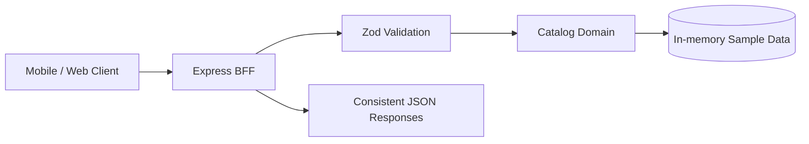

<div align="center">

# ⚡ Node BFF Reference

### A clean, typed API gateway foundation for modern frontend applications.

**Node.js · TypeScript · Express · Zod · API Design**

[](https://nodejs.org/) [](https://www.typescriptlang.org/) [](#architecture)

*A portfolio reference focused on maintainable backend design, predictable contracts, and pragmatic engineering.*

</div>

---

## ✨ Why this project?

A **Backend for Frontend (BFF)** provides a dedicated API surface tailored to a client application. It can simplify data contracts, consolidate upstream requests, and keep frontend-specific orchestration outside shared backend services.

This reference is intentionally small: it demonstrates core patterns without pretending to be a production-ready distributed system.

## 🏗️ Architecture



| Layer | Responsibility | Location |
| :--- | :--- | :--- |
| **HTTP boundary** | Routing, validation, response formatting | `src/app.ts` |
| **Domain** | Typed product data and lookup behavior | `src/catalog.ts` |
| **Runtime** | Startup and graceful shutdown | `src/server.ts` |
| **Tests** | Deterministic domain behavior | `tests/` |

## 🚀 Getting started

**Requirements:** Node.js 20+ and npm.

```bash
npm install
npm run dev
```

Try the API:

```bash
curl http://localhost:3000/health
curl 'http://localhost:3000/api/v1/products?search=keyboard'
curl http://localhost:3000/api/v1/products/p-101
```

## 📡 API contract

| Method | Route | Behavior |
| :--- | :--- | :--- |
| `GET` | `/health` | Health response |
| `GET` | `/api/v1/products` | List products, optional `search` |
| `GET` | `/api/v1/products/:id` | Get one product or a structured 404 |

**Example response**

```json
{
  "data": [{ "id": "p-102", "name": "Mechanical keyboard", "price": 119, "currency": "EUR" }],
  "meta": { "count": 1 }
}
```

Errors follow a consistent shape: `{ "error": { "code": "...", "message": "..." } }`.

## 🧪 Quality checks

```bash
npm run typecheck
npm test
npm run build
npm start
```

The included tests cover domain behavior. HTTP integration tests, load testing, and security verification are recommended next steps, not completed features.

## 🧠 Engineering decisions

- **Strict TypeScript:** surface mistakes before runtime.
- **Zod at the boundary:** reject invalid query inputs early.
- **Versioned routes:** make future API evolution more deliberate.
- **Consistent errors:** simplify client-side handling.
- **In-memory data:** keep the reference easy to run and review; replace it with an adapter for real services.
- **Graceful shutdown:** close the HTTP listener on termination signals.

## 🛣️ Production roadmap

- [ ] Introduce service adapters and upstream timeouts
- [ ] Add request IDs, structured logs, and tracing
- [ ] Add authentication, authorization, and rate limiting
- [ ] Add HTTP integration and contract tests
- [ ] Add CI and containerized deployment
- [ ] Define caching, retries, and circuit-breaker policies where justified

## 👤 About the author

Created as a technical portfolio reference by [Cristian / Crisesm](https://github.com/Crisesm), drawing on experience in React Native, React, Node.js, and technical leadership.

Explore also: [Mobile Platform](https://github.com/Crisesm/mobile-platform) · [Tech Lead Handbook](https://github.com/Crisesm/tech-lead-handbook)

---

<div align="center"><sub>Simple contracts. Explicit boundaries. Sustainable delivery.</sub></div>
